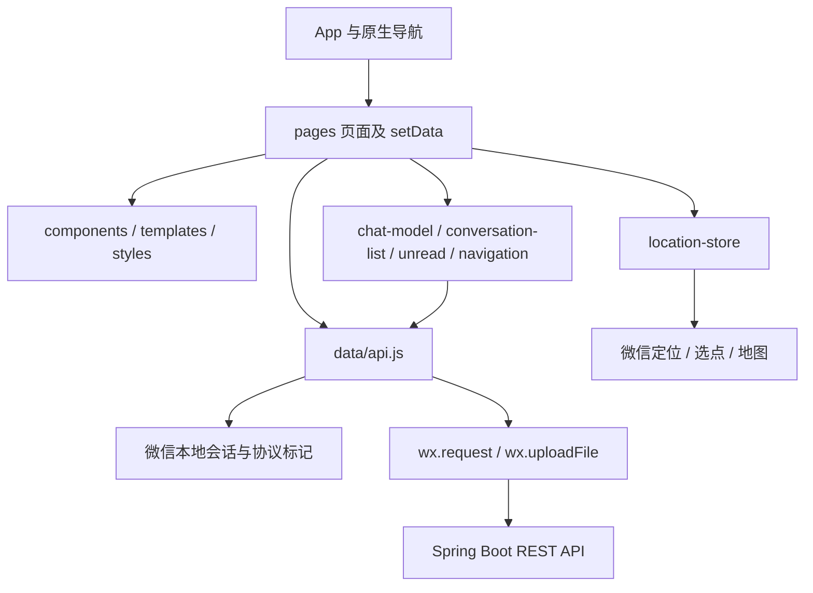

# 球友赴台｜微信小程序前端

同城台球约球产品的原生微信小程序：游客浏览、发布约球、一对一沟通、双方确认、微信联系及个人记录。配套后端为独立仓库 `qiuyoufutai-server`。

> 更新：2026-11-02。本文按当前源代码编写；已实现、已部署和已验收是不同状态。

## 1. 技术架构

### 技术选型

| 层次 | 当前实现 |
| --- | --- |
| 运行平台 | 微信原生小程序，无跨端框架 |
| 页面 | WXML + WXSS + JavaScript，原生navigation/tabBar |
| UI复用 | 自定义Component、WXML template、共享WXSS |
| 状态 | 页面`data/setData`、模块函数、少量`App.globalData`；没有独立全局状态库 |
| 网络 | `wx.request` / 头像`wx.uploadFile`，HTTPS REST |
| 登录 | `wx.login` + 后端不透明Bearer会话；非前端签发JWT |
| 实时性 | 页面前台轮询、历史增量读取及返回恢复；非WebSocket |
| 本地数据 | 微信Storage存储会话、协议接受/提醒标记、用户位置等；业务记录在后端 |
| 检查 | Node.js内置测试框架；真实编译和预览使用微信开发者工具 |

### 模块与调用方向



页面负责生命周期与交互；`data/`模块负责请求、展示状态推导和导航。现有页面也包含业务编排，没有另外一套Repository或Service层。小程序不访问MySQL、也不持有微信AppSecret或COS密钥。

`templates/my-game-card.wxml`和`styles/my-game-card.wxss`供约球首页、发起/聊过记录复用；`conversation-group`供消息中心及某场聊天列表复用，由参数决定是否展示约局分组标题。不要为同一类卡片复制另一套结构。

### 状态与权限边界

- 页面状态用于展示，服务端状态是权限和业务结果的最终依据。按钮隐藏不能代替服务端校验。
- `chat-model.js`推导确认进度、落选、取消、到期和账号关闭后的只读状态；不能发送时隐藏输入区、显示底部简短原因。
- 位置在本机计算估算距离；当前分页结果的距离排序不等于服务端全局距离分页。
- `App.globalData`用于少量跨页恢复意图，如完善资料后继续发布；不是持久业务数据库。

## 2. 关键数据流程

### 浏览与登录

公开列表和详情可匿名请求。受保护操作经登录引导；`wx.login`的code发给后端换取会话，令牌存储在设备，后续请求携带Bearer。并发登录复用进行中的Promise；收到401清除失效令牌并在受保护请求中最多重新登录重试一次，不自动重试结果未知的网络写请求。

成功响应读取`{data: ...}`；失败响应读取`{error: {code, message}}`，页面根据错误码及状态展示提示。登录失败不应被包装成空列表或发布成功。

### 发布与确认

发布入口→资料完整性检查→发布/草稿表单→API持久化。点击“确认组局”仅进入聊天，必须在聊天确认卡明确操作；服务端决定最终会话，再由轮询返回更新页面。发布和发送使用请求标识区分同次操作重试。

### 聊天与消息

聊天页加载会话和约局→读取历史→前台同步消息与状态→更新未读/确认/关闭提示。页面隐藏或销毁时停止轮询，返回恢复。状态不在不同入口分别实现；详情、我的记录、消息中心最终均进入同一聊天页。

通知列表正文来自服务端`/v1/me/notifications`；聊天页提示来自前端状态模型，两者不能混为同一套文案。聊天结束不修改已组局业务结果。

## 3. 工程目录

| 路径 | 职责 |
| --- | --- |
| `app.js` / `app.json` / `app.wxss` | 应用生命周期、路由与四个原生 tab、全局样式 |
| `pages/` | 首页、找球、约球、我的、详情、发布、聊天、记录及设置页面 |
| `data/api.js` | 服务地址、请求、登录会话、字段转换和业务API |
| `data/chat-model.js` | 确认进度、可发送/只读状态与关闭原因 |
| `data/match-chat-route.js` | 招募进入会话列表、已组局直达最终会话 |
| `data/conversation-list.js` / `data/unread.js` | 消息列表展示、分组和未读同步 |
| `data/location-store.js` | 本机位置、距离计算和地图入口 |
| `data/legal-documents.js` | 协议正文和版本号；变更时须同步后端当前版本 |
| `components/` | 登录引导、已组局取消原因弹窗 |
| `templates/` / `styles/` | 约球卡片、聊天列表的共享模板和样式 |
| `assets/` | 黑八等静态资源 |
| `tests/` | Node.js 内置测试框架用例，不参与小程序打包 |

底部导航固定为：首页、找球、约球、我的。发布为页面内入口，不是独立 tab。

## 4. 本地开发与环境连接

1. 安装微信开发者工具，将**本仓库目录**导入为小程序项目。
2. 使用与后端 `WECHAT_APPID` 对应的小程序 AppID；配置见 `project.config.json`。
3. 检查 `data/api.js` 中的 `API_BASE_URL`，确认连接目标环境。
4. 编译后从欢迎页进入，可选择登录或先浏览；发布和聊天需可用的微信登录后端。
5. 开发者工具运行、预览、上传和发布是不同步骤；本仓库没有需要先执行的 npm 构建流程。

当前代码中的服务地址：

```text
https://springboot-r9wn-336416-13-1518350960.sh.run.tcloudbase.com
```

地址用途及线上版本须由部署方确认。真机的 `127.0.0.1` 指向手机本身；需要访问电脑本地服务时，应使用手机可达地址并满足对应环境网络要求。正式发布前确认 HTTPS、证书及微信后台请求域名配置；不要把开发者工具临时关闭域名校验当作真机问题的解决方案。

前端只通过 `wx.login` 获取一次性 code，交由后端换取会话；**AppSecret、数据库密码和对象存储密钥不得写入小程序**。

## 5. 功能与页面约定

- 游客可浏览公开列表和详情；发布、聊天、确认和个人记录等在操作时引导登录。
- 新账号创建需同意当前协议；已有账号不因协议更新被阻止登录。更新提示短暂展示，设备按版本去重。
- 约球的“我发起的 / 我聊过的”各展示最近两条。“查看全部”分别进入发起记录或聊过记录；状态为全部、组局中、已组局、已过期、已取消。
- 草稿仍在我发起的下方单条展示；记录筛选不提供编辑中。
- 首页和记录页复用 `my-game-card` 模板，卡片主体进详情，不额外添加查看详情按钮。
- 招募发起人进入该场聊天列表；已组局进入最终一对一聊天。消息中心按约局分组，该场聊天列表不重复约局摘要。
- 双方必须在聊天确认卡明确操作才计数；点击公开卡片“确认组局”只是导航。
- 招募到期开球后30分钟只读；已组局确认后24小时只读，记录仍是已组局。取消、落选和账号关闭也会只读，底部始终显示简短状态，不重复说明历史可查看。
- 已组局取消仅最终双方可操作，原因必填；窗口由后端返回，默认允许至开球后30分钟，不在前端另写一套时间常量。招募中取消保持原确认流程。
- 微信号在“我的”卡片弹窗维护，×清空后保存可删除。详情仅最终组局双方可复制，不再逐场授权；缺失时引导前往我的填写。
- 通知图标按含义区分：确认浅绿、取消浅红、结束浅暖灰。未读由红点表示。

## 6. 前后端契约与生效方式

| 改动 | 生效步骤 |
| --- | --- |
| 布局、图标、颜色、前端提示或路由 | 编译/预览对应小程序代码；线上用户需要小程序发布版本 |
| 通知列表正文、鉴权、状态判断、取消权限、接口返回 | 后端构建部署；若同时改变接口契约，还需配套前端 |
| `data/legal-documents.js`的协议版本 | 同步核对后端`LegalConsent`版本及新旧账号处理，再配套发布 |
| 数据库结构/数据迁移 | 后端新增Flyway迁移，随启动执行；普通文案改动不必新增迁移 |

`pages/messages/index.wxml`显示接口返回的通知正文；聊天页的状态提示主要由 `data/chat-model.js` 生成。两处文案来源不同。

**Git push 不等于手动部署，也不证明服务未部署。** 云托管若配置了提交触发构建，推送可能自动更新服务。应核对控制台构建记录、运行版本与API响应，不能仅凭“我没有点部署”推断后端版本。

## 7. 修改与发布流程

- 共用卡片应修改共享模板/样式，避免约球首页与记录页出现两套视觉。
- `app.json`使用`lazyCodeLoading: requiredComponents`启用按需注入，各页面须在自己的`usingComponents`中声明实际依赖；不能依赖未访问页面的顶层代码执行。
- 按需注入与用时注入不同：后者还需`componentPlaceholder`，仅在首次渲染时注入。目前弹窗节点常驻并通过`selectComponent().open()`调用，本轮未增加占位组件；后续如改成条件挂载，须先处理组件就绪和首次点击调用。依据[微信代码注入文档](https://developers.weixin.qq.com/miniprogram/dev/framework/ability/lazyload.html)及[占位组件说明](https://developers.weixin.qq.com/miniprogram/dev/framework/custom-component/placeholder.html)。
- 黑八资源使用384×384透明PNG，覆盖当前最大246rpx头像预览；新增资源需核对实际显示尺寸与打包体积，避免直接放入大尺寸原图。README和测试文件排除出小程序运行包。
- `project.config.json`已显式包含`components/cancel-match-dialog`、`styles`、`templates`。新增共享资源后如出现依赖过滤或WXSS找不到文件，先检查路径与打包规则，再重新编译。
- 接口契约变化先确认目标后端兼容；云托管部署成功后再联调小程序。前端改动不能解决后端权限或数据库问题。
- 推送按用户明确指示执行，提交说明使用中文。上传体验版不等于发布正式版。

## 8. 检查与验收

需安装 Node.js；这些命令不会编译微信小程序，也不能替代真机验证：

```sh
node --check pages/chat/index.js
node --test tests/*.test.js
```

微信开发者工具和双人真机应覆盖：游客浏览、登录、发布/单草稿、确认竞争、取消原因及通知、最终双方微信复制、24小时只读、权限拒绝和键盘表现。测试目录只是本地检查，不会随小程序上传。

## 9. 当前边界与相关文档

- 官方微信内容安全、微信订阅消息尚未接入；基础联系方式拦截不是官方审核。
- 手机号/虚拟号码、公开信用分、改期审批和时间冲突检查不在当前范围。
- 公开列表当前仅招募中；历史“已组局继续公开24小时”约定与实现存在差异。
- 距离按已加载分页结果计算，不能保证全量全局最近优先。单草稿入口也不等于后端唯一草稿约束。
- 图标、键盘、地图和安全区须真机确认；不将HTML设计稿视为真实小程序运行结果。

若本仓库位于完整工作区中，产品文档及UI状态稿在上级 `outputs/`；独立克隆本仓库不会自动包含这些稿件。业务接口配置与部署详见后端README。
